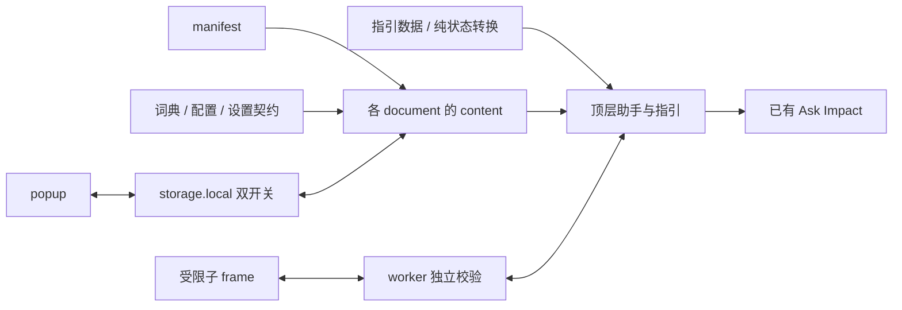

# 架构设计与实现边界

本文件用于 0.9 交接，解释当前实现的模块关系和维护边界。
当前源码版本、实际加载版本、已通过范围、失败和未测项，只读 [PROJECT_STATE](../../PROJECT_STATE.md)。
明确下一步只读 [NEXT_TASK](../../NEXT_TASK.md)；长期操作与隐私规则见 [AGENTS](../../AGENTS.md)。
这里不另设状态入口，也不把静态实现描述当作实页验收。

## 1 运行形态与模块职责

扩展采用 Chrome Manifest V3，无应用构建步骤；浏览器按 manifest 顺序加载静态文件。
真实目标为 `demo.impact.com` 与 `app.impact.com`；仓库的 `demo/` 是历史测试材料。

| 文件 | 当前职责 |
| --- | --- |
| `manifest.json` | 声明注入目标、脚本顺序、worker、popup、CSS 与图标。 |
| `dict.js` | 固定文本、译文、语境 scope、概念主题及元数据；不负责遍历或发送请求。 |
| `site-config.js` | 已观察的正文根、Shadow 宿主、受限 frame、原生 AI 与指引组件适配。 |
| `settings-contract.js` | 双开关键名、默认值、消息名与解码；不产生存储或 DOM 副作用。 |
| `guidance.js` | 分组、步骤、说明、问题分支和公开链接；内容版本与扩展版本独立。 |
| `journey.js` | 无 DOM、存储或业务数据的纯状态转换、状态校验、场景与合法边。 |
| `content.js` / `content.css` | 每 document 翻译与恢复；顶层助手、概念入口、指引展示及资源清理。 |
| `background.js` | frame 授权与转发、受限几何桥、按 tab 串行处理的指引检查点。 |
| `popup.html` / `popup.js` / `popup.css` | 扩展弹窗的设置、保存、页面状态查询和显示。 |

普通 Impact document 的加载顺序：
`dict → site-config → settings-contract → guidance → journey → content`，另加载 `content.css`。
manifest 使用 `document_idle`、`all_frames`，普通分支另有 `match_origin_as_fallback`。
四个精确 assets 文档只加载 `dict → site-config → settings-contract → content`。
assets 分支没有助手、连续指引和概念 AI 操作；Review srcdoc 还需运行时证明原生父框关系。
worker 通过 `importScripts` 独立加载词典和纯状态模块；popup 先加载设置契约再加载控制脚本。

## 2 每 document 的翻译与恢复

每次注入有独立闭包、原文记录、待扫描根、观察器和生命周期；frame 不共享父页的节点缓存。
`translateTree` 遍历现有 Text 与开放 Shadow；`translateNode` 先验资格和 scope，再匹配固定源文。
匹配支持 exact，以及有明确固定边界的 prefix、suffix、numeric-template。
计数模板只接受校验后的数字槽，不把名称、ID、金额或日期当作可变占位符。

`originalValues` 以 WeakMap 保存节点原文和本次译文，`translatedNodes` 跟踪需恢复的节点。
框架重写 Text 后，当前文本成为新源文；不能拿先前缓存覆盖框架的新状态。
关译仅在节点仍是插件写入的译文时恢复对应原文。
节点断开、scope 失效或进入保护区域时，`pruneNodes` 恢复并释放适用记录。
同一原生节点重插后可重新判定，避免旧页面缓存长期保留。

翻译不以可见性为前提：已挂载的折叠固定 Text 也可翻译，展开不要求用户反复拨开关。
可见浮层、隐藏缓存副本与展开栏是不同节点，验收必须针对实际显示的表示。
原生内容不使用 `innerHTML` 重建，不修改组件或 `attachShadow` 原型。
助手、问号、样式和定位图层是插件自有节点，使用独立标记并在关闭或销毁时按归属清理。
仅两个已观察合同时间行允许移动限定结构内的原节点，关译或销毁恢复，不扩展该例外。

## 3 自动发现与范围判定

document body 与每个已发现的开放 ShadowRoot 分别注册 MutationObserver。
新增子树、Text 改写及受观察的 class、id、href 等属性变化进入待扫描队列。
`schedule/flush` 约 32ms 合并扫描，并消除被父根覆盖的重复子树。
一秒轮询补查路由、父框资格、场景及新 ShadowRoot；不依赖劫持框架方法。
菜单子树重挂、新导航宿主出现和已有宿主延迟开放 Shadow 可沿现有发现机制处理。
closed（封闭）ShadowRoot 不可遍历；未观察的纯属性变更不能凭设计说明宣称已经实测覆盖。

资格分两层：`inLocalizationScope` 判允许扫描的组件，`scopeMatches` 再判具体词条。
scope 可约束域名、document 路径、精确路径、查询、顶层外壳、Shadow 宿主和原生父链。
`textParentSelector` 可进一步限定承载该 Text 的直接元素；必要的上下文标签要求唯一匹配。
通用 root 命中不等于任意同名英文都允许翻译，词条 scope 始终另验。

共享导航按品牌端组件复用：advertiser 路径、真实导航 Shadow、产品双标记及固定叶共同限定。
原有更精确的页面词条优先，共享 fallback 补正常页面，不做全局裸词替换。
正文和 BODY portal 仍按各自精确组件处理，不能为一个提示把所有 tooltip 加入通用 roots。
新增漏译先区分源文、真实叶、scope、扫描资格和挂载时序，避免直接扩大扫描范围。

输入、可编辑内容、用户内容标记、受保护名称区域及原生 AI 回复在跳过规则内。
无显式 value 的 option 不改文字，避免改变原生提交值；placeholder 等属性不属于 Text 翻译。
已确认列内的有限固定状态可用专属词条；业务行的名称、订单 ID、金额、日期等不得模板化。
同名业务值应留作反例，不能只用“译后看起来正确”推断保护成立。

## 4 双开关与助手位置

契约键为 `impactCNEnabled` 与 `impactCNAIEnabled`，只有显式 false 表示关闭。
两个开关独立持久化在 `chrome.storage.local`；各 document 监听 local 变化并只应用差异。
popup 先保存再通知当前页面；助手或消息入口先应用，再保存对应开关。
存储失败有提示，不把当前页面状态直接等同于已成功持久化。
关译恢复原文；关 AI 取消未发送请求并移除对应入口，不关闭翻译或执行新的提问。
AI 关后立即重开不能复活此前待发请求。

仅顶层创建助手；拖动位置保留在当前页面内存，刷新复位，不作为持久设置。
布局逻辑避让原生 AI、聊天及相关遮挡区域；位置调整不改业务控件。

## 5 frame、worker 与原生 AI 的独立边界

manifest 匹配只表示可以注入，不表示该 document 获得翻译、AI 或定位运行授权。
同源 Checklist frame 需核顶层外壳、唯一原生 frame 槽位、源路径和实际 document 关系。
Review srcdoc 另验父关系与 sandbox；opaque sandbox 不作为可核关系。
跨域 assets 由 worker 核固定源文档与顶层 Checklist 路由，再返回固定公开路由标识。
子 document 和词条继续独立验 scope，不以 worker 一次允许代替内容侧判断。

概念入口只使用已有 Ask Impact，不新增 AI 后端，不伪造服务答复。
顶层按固定主题构造单一概念问题，并要求对应官方 HTTPS 链接；不拼接当前业务行。
已有草稿、输入禁用、控件重复、发送未就绪及异步取消都应保留用户原生草稿。
发送前后使用代次和路由检查，原生控件重挂后重新核对实际输入框与发送按钮。

受限业务 frame 仅发送 `topicId`；worker 分别核 sender、frame、document、源页、顶层页和主题关联。
同一词条需同时证明源页和外壳适用，不能拼接两个不相关 scope 来授权一个主题。
发送前再确认原 document 仍有效；frameId 被复用不能代表同一个 document。
Checklist assets 的“可翻译”资格不授予 frame 概念提问能力。

跨域定位另走几何桥，只允许固定角色、请求 ID、context epoch、视口和有限矩形。
子框与 worker 分别验证 document、角色和字段；父页再核请求仍当前、frame 和几何是否一致。
不跨域读取正文或按钮业务值，也不代替用户点击目标。
共享导航词条扩大到同组件的更多页面，不扩大上述 AI、frame 或几何授权。

## 6 指引、场景与任务隔离

`guidance.js` 提供说明；`journey.js` 只处理纯状态；content 观测页面并消费转换结果。
显示已到达、用户声明已操作和业务成功是三个不同事实。
纯状态的 `businessResult` 固定为 unknown，阅读和操作声明只属于当前助手实例。
新识别场景的空闲卡片可对应当前位置；同一场景轮询保留用户手选的其他说明。
显示正确说明不自动开始连续任务，也不恢复旧声明、定位或 AI 请求。

| 页面语境 | 判定与说明 |
| --- | --- |
| 网站设置 | 已知 Checklist 槽位、同源正文与固定组件，映射 5b。 |
| 验证正文 | 已知 assets frame 的外框和固定路径，映射 6a；不等于内部业务结果。 |
| 无 engage 的测试列表路径 | 独立列表场景 tests，映射 6c。 |
| launch-test-action 工具路径 | 独立工具场景 tool，映射 6a。 |
| engage/test-actions 同 URI | 唯一列表根／标题／表格，或唯一工具根／标题／Run Test 排他判定；否则 unknown。 |

不能仅凭 `#templateContainer` 判断工具，列表也可能保留该容器。
工具与列表混挂、缺失或重复时不猜测；worker 仅对该精确双模式地址允许 tests/tool。
定位仍要求唯一原生目标、可见几何、裁切和遮挡检查；隐藏折叠组先指组标题。
帮助侧栏存在时，已观察的两步先指原生关闭控件，手动关闭后再跟随到正文入口。
取消、关闭、路由或上下文失效后，旧异步回包不得重新绘制定位。

Program 菜单选择在原生切换前捕获；选中标记、页头和实例链接只在当前 document 内存比较。
这些信号用于发现变化，不是跨 document 的稳定 Program 身份凭据。
上下文变化增加 navigation/checkpoint 代次、换 context epoch、清声明并取消旧定位。
frame 身份、正文 document、frame 查询、顶层 path/query 和页面离开分别参与失效判断。
待发 AI 还绑定 AI 代次及路由，离开再返回也不能复活原请求。

## 7 检查点仅保存未核对来路

worker 的内存 owner 绑定 tab、document、context epoch 和递增 seq，并按 tab 串行处理。
`storage.session` 只保存公开场景、随机任务令牌、状态和有限待到达边；不保存业务 ID 或声明。
待到达边有 120 秒有效期；读取前后重核当前顶层 document，取出即消耗，重复取不复活任务。
跨 document 只能显示一次“项目来路无法核对”的暂停说明，不能自动恢复活动任务。
worker 休眠后重绑需仍当前；旧 put 快照不得覆盖等待期间合法推进后的新状态。
双模式页面的未知外壳不能绑定检查点，组件明确后只重取通常的未核对说明。
晚到 take 回包的场景已过时则忽略；关闭或新意图也有独立代次保护。

## 8 初始化、销毁与资源所有权

`initialize` 等待 assets 资格和存储时检查 destroyed，再创建助手、计时器与监听器。
`destroy` 可重复调用，断开观察器、清计时器／监听、取消定位、恢复 Text 并移除自有节点。
初始化等待期间被销毁后，不应继续注册资源；当前实现已有对应检查。
设置契约也已是独立模块，popup 与 content 消费同一解码约定。
[旧架构概要](../ARCHITECTURE_08_BRIEF.md)是以 0.7.10 工作区为基线的历史风险评估。
其中设置契约和初始化销毁竞态的旧问题，不能直接重列为当前待修事项。

## 9 打包、验证与本次阅读边界

源码目录为 `impact-cn-mod/`；使用 `python3 scripts/package-extension.py` 生成版本 ZIP。
脚本先核 manifest 声明资源，固定 ZIP 时间与权限，拒绝用不同字节覆盖同版本旧包。
它打包源码目录内文件；新增调试材料不得混入该目录。
同版解压目录、根 manifest、资源清单、CRC、安全路径及源码／ZIP／目录全字节另行核对。
旧 dist 和报告保留；手动加载后在正常 Impact 页独立核实际版本，禁止自动操作扩展管理页。
商店材料与发布版本另核，架构说明或候选打包通过不代表实页、业务或商店验收通过。

修改按影响面选择现有定向测试：词条组件、恢复／重挂、设置、journey/worker 或几何协议。
合成、历史、当前实页和未测分开记录；失败保留，不把旧 PASS 转记为新包全量通过。
后续执行必须回到 [PROJECT_STATE](../../PROJECT_STATE.md) 和 [NEXT_TASK](../../NEXT_TASK.md)确定当时范围。
